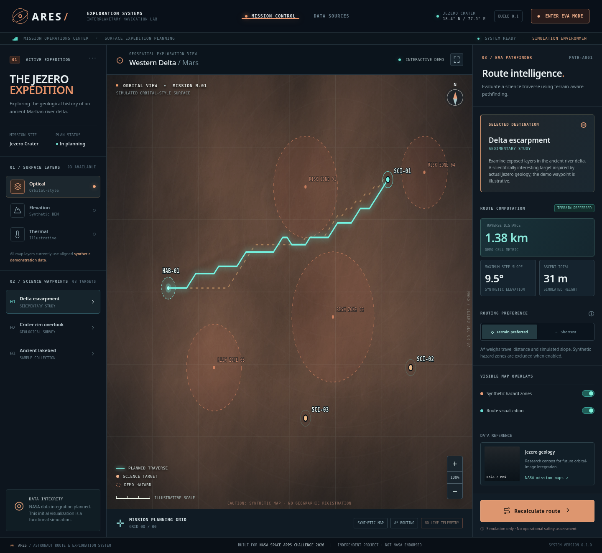

# ARES / Astronaut Route & Exploration System



**NASA Space Apps Challenge 2026** — [Interplanetary Survival Guide: Martian Map](https://www.spaceappschallenge.org/2026/challenges/interplanetary-survival-guide-martian-map/)

ARES is a cinematic, interactive **Mars surface mission-planning prototype**. This prototype demonstrates the interaction model, UI, and a working explainable A* routing engine without pretending to have integrated flight-quality geospatial datasets.

> **Prototype transparency:** The bundled terrain, height field, thermal coloring, hazards, waypoints, scale, and distances are **synthetic illustrative demonstration data in the default fallback**. They are *not* a NASA/USGS DEM, Mars orbital mosaic, validated physical hazard map, or real-time measurement. Coordinates displayed as Jezero regional context are not registered to the bundled map. The router is real software running on demo input, not certified EVA planning.

## Quick start (no dependency installation)

Requirements: Node.js 22 or newer.

```bash
npm run dev
```

Open **http://localhost:4173** in a current browser.

```bash
npm run test   # A* planner tests
npm run build  # Copy static deployable site to dist/
npm run check  # both
```

You can publish the contents of `dist/` on any static host. This starter intentionally has **zero production or build dependencies** so the team can demo it quickly without spending time on package setup.

## Current features (v0.2)

- A production-inspired 1440px Mission Control interface with responsive layout.
- Three visibly distinct, locally bundled, aligned demo map layers: optical style, elevation visualization, thermal style.
- Interactive science waypoint selection via sidebar and surface-map markers.
- 8-direction A* route planner. Terrain-preferred routing weighs synthetic slope; shortest-path mode minimizes distance while avoiding enabled synthetic hazard zones.
- Dynamic route distances, segment maximum slope and accumulated ascent based on the bundled demo height field.
- Toggle demonstration hazard zones and optional route visibility.
- Mission telemetry UI, zoom controls, fullscreen attempt, simplified EVA mode.
- NASA science-resource link and provenance notes, with explicit labeling of all simulated content.
- 9 algorithm / pack-validation unit tests and an offline raster importer smoke test.
- Export a route briefing as JSON, including route-cell coordinates, metrics, and clear research-prototype warnings.
- Optional real-data pack loader with projected metre coordinates, science-data provenance card, and hatching for no-data DEM cells.
- Python pipeline for co-registered Mars-projected optical GeoTIFFs and DEM; missing data never becomes traversable ground.
- The original synthetic demo remains available if scientific data is absent or malformed.

## Project structure

```text
ARES-Mission-Control/
├── index.html                     # Mission Control interface
├── sources.html                   # Scientific reference / data honesty page
├── styles.css                     # Main responsive design system
├── public/
│   ├── mars-demo-terrain.webp     # Synthetic, locally rendered surface
│   ├── mars-demo-elevation.webp   # Matching synthetic elevation visualization
│   ├── mars-demo-thermal.webp     # Matching synthetic thermal visualization
│   └── data/                     # Optional imported mission pack (not bundled by default)
├── src/
│   ├── main.js                    # UI state, event handlers, SVG visualization
│   ├── data/demo-terrain.json     # Height grid, synthetic hazard locations
│   ├── data/mission-pack.js      # Validates projected scientific data pack
│   └── engine/routing.js          # A*, slope, route scoring
├── tests/routing.test.js
├── tests/data-pack.test.js
├── tools/
│   ├── dev-server.js              # Zero-dependency Node HTTP dev server
│   ├── build.js                   # Static build to dist/
│   ├── generate_demo_terrain.py   # Reproducible synthetic data generator
│   ├── import_mars_rasters.py    # Offline importer for projected Mars GeoTIFFs
│   └── test_raster_import.py     # Fixture-driven importer smoke test
├── IMPORT_REAL_DATA.md           # Detailed import steps and limitations
├── DATA_SOURCES.md
└── PHASE_2_PLAN.md
```

## Scientific upgrade path

The v0.2 importer and data-pack loader are available; see [IMPORT_REAL_DATA.md](IMPORT_REAL_DATA.md). **No measured NASA/USGS raster has been packaged yet.** The next task is downloading a matching Jezero optical + DEM crop, verifying the source metadata, and running the importer.


The next step is to **select an exact Jezero footprint with matching reference data**, then replace simulated data *as a coordinated dataset*:

1. Download and crop a USGS/NASA-referenced Jezero orthomosaic **and** co-registered DEM. Record CRS, bounding box, pixel resolution, vertical datum, and attribution.
2. Reproject and resample both to the same exact local grid. Preserve `nodata` masks. Render tiles/images and export a compact elevation array with real units.
3. Derive physically meaningful slope from **horizontal meter spacing** and elevation, flag unknown regions, and exclude them from routing pending review.
4. Ground sample waypoints in actual mapped geology. Only mark hazards when supported by imagery or a dataset, plus resolution and confidence.
5. Add thermal information at its actual resolution/time coverage. If data is global or regional, do not imply it has meter-scale accuracy.
6. Show source ID, capture date, units and uncertainty for *every layer*.
7. Evaluate route distance and obstacles against manually inspected examples. Obtain a domain expert review before suggesting any operational safety use.

See [DATA_SOURCES.md](DATA_SOURCES.md) for official data links and [PHASE_2_PLAN.md](PHASE_2_PLAN.md) for team tasks.

## Why no React yet?

For the first hackathon milestone we prioritized a **runnable, dependency-free, easy-to-present starter**. The UI code is intentionally modular at the routing and data layers. Moving the view to React/TypeScript and integrating Leaflet is the next step if time permits, not a prerequisite for demonstrating a complete route workflow.

## Design system

Deep space navy `#070d14` · oxidized Mars orange `#e9946a` · route cyan `#71e3d9` · warning amber.

Space Grotesk and IBM Plex Mono are optional remotely loaded fonts; system fallbacks preserve offline usability. Mission maps and tests work without network access. The scientific reference thumbnail, if available, is fetched from NASA's website; the synthetic main map is always local.

## Credits / integrity

- Built independently for NASA Space Apps Challenge 2026; **NASA does not endorse this project**.
- The Jezero scientific scenario was inspired by official NASA Perseverance mission materials.
- Remote NASA images and linked resource materials retain their respective NASA/JPL credits.
- Terrain illustrations are synthetic and generated specifically for the starter. No NASA image has been altered or falsely positioned as georeferenced imagery.

**Safety:** This is a hackathon research and interaction prototype, not a life-support, spaceflight, or EVA navigation product.
