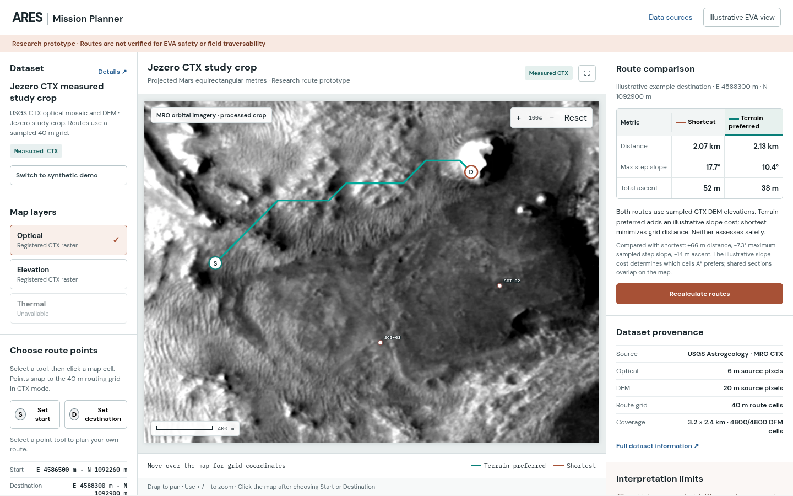

# ARES Mission Planner



ARES is a research prototype for comparing routes on a measured Jezero CTX optical mosaic and sampled digital elevation model. It uses a dependency-free web UI and an eight-direction A* routing engine. It is **not** an EVA safety or field-traversability system.

## Deployment and large datasets

The live research preview is hosted on **Cloudflare Workers Static Assets** at [spcapps.openstacktool.com](https://spcapps.openstacktool.com/), not Cloudflare Pages. `wrangler.json` points to the generated `dist/` directory and enables SPA navigation fallback. Git-linked Workers Builds must run **build: `npm run build`**, then **deploy: `npx wrangler deploy`** from the repository root. Deploying raw repository files instead of `dist/` will omit the generated `build-info.json`.

See [Phase 7 Workers deployment and live verification](docs/PHASE7_WORKERS_RELEASE.md) for current setup and checks. The earlier [Pages + R2 design](docs/PAGES_R2_DATA_ARCHITECTURE.md) remains an alternative/reference, not the current hosting platform.

The current web app uses compact CTX WebP/JSON assets and does **not** need the original multi-gigabyte TIFFs. Keep source GeoTIFFs outside Git; optionally back them up in private R2. Future high-resolution regions need a separately implemented, validated tile loader and derived map assets. The build checks for accidental raw rasters, sensitive files and oversized files in `dist/`.

**Note:** Repository changes alone do not prove Cloudflare deployed the new version; verify the live build ID, data, deep links, and response headers after each production deployment.

## Run

Requires Node.js 22 or newer.

```bash
npm run dev      # http://localhost:4173
npm run test     # routing, data, map geometry and mode tests
npm run build    # static site in dist/
npm run check    # tests and build
```

## Plan a route

1. The measured CTX pack loads by default. Choose **Optical** or **Elevation** for the same registered crop.
2. Select **Set start** or **Set destination**, then click the map. Each point snaps to a routing cell; unknown DEM cells and enabled demo hazards are rejected.
3. Compare **Shortest** and **Terrain preferred** in the right panel. The selected column determines which line is emphasized. Drag to pan; use the zoom controls to inspect the map.
4. Open **Details** for source URLs, CRS, bounds, vertical reference, resolution and coverage. Export the route briefing as JSON if needed.

## Mission Library (Phase 8)

Use the **Mission Library** sidebar to browse 30 measured-grid scenarios (10 Explorer, 10 Scientist, 10 Commander). Filter by phase, search by title/ID/objective, then select a scenario to load its ordered stops. The map shows the aggregate route through every fixed-order leg. The right panel compares summed distances/ascent and maximum sampled step slope, and lets you export all calculated legs and metadata as JSON. **Exit mission** returns to the original comparison. See [Phase 8 implementation and QA](docs/PHASE8_MISSION_LIBRARY.md).

The Commander plans do **not** optimize the order of stops; each leg runs separately on the existing A* algorithm. All mission coordinates are illustrative measured-grid exercises, **not** independently identified Jezero science targets or EVA-safe routes. The canonical catalog is `data/scenarios/measured-missions.json` and is bundled into `dist/data/scenarios/` by the build.

The **Science Targets** explorer keeps a Jezero catalog and a global Mars catalog separate. Its submitted Jezero coordinates currently lie outside the measured crop, or have no single point, so none becomes a named route preset. The collapsed **Space Weather** drawer makes a read-only NASA CCMC DONKI request for observed solar events when opened. It reports UTC event and retrieval times and displays an unavailable state if the request fails. These events do not measure local Mars radiation or establish EVA safety.

Use **Switch to synthetic demo** or `?mode=demo` for the separate illustrative dataset. The synthetic mode includes illustrative hazards and thermal coloring. Measured CTX mode has **no** thermal or verified hazard layer.

## Custom Mission Builder (Phase 8.1)

Create your own measured CTX missions with **New mission**, or select one of the 30 catalog scenarios and use **Duplicate selected** to edit a copy. Add valid grid stops by clicking the map, drag an existing stop to move it, drag a grip in the left panel to reorder it, or use ↑/↓ for keyboard-friendly reordering. Choose **Pan map**, **Drag stops** or **Add stop on map** to avoid conflicting gestures. A custom mission supports 2–8 fixed-order stops and up to 30 undo steps, recalculating two A* alternatives on each accepted change.

**Save mission JSON** exports the editable blueprint; **Load JSON** reopens that specific file format after validating measured-dataset compatibility and grid cells. The calculated mission report is a separate export. No account, server-side storage, or unverified EVA safety model is implied. See [Phase 8.1 guide and QA](docs/PHASE8_1_CUSTOM_MISSION_BUILDER.md).

## Measured data

The bundled `JEZ_ctx_B_soc_008` pair comes from the [USGS Astrogeology Mars 2020 CTX archive](https://asc-pds-services.s3.us-west-2.amazonaws.com/mosaic/mars2020_trn/CTX/index.html). The source optical mosaic is 6 m/pixel and the DEM is 20 m/pixel, both in the Mars Equirectangular IAU sphere projected CRS. The selected crop covers E 4,586,000–4,589,200 m and N 1,091,000–1,093,400 m. Routing uses 80 × 60 cells at 40 m spacing. The two WebP display layers share the crop bounds; numerical heights come from the DEM array in `public/data/mission-pack.json`.

The source DEM metadata states elevation units of metres relative to the Mars 2020 IAU sphere of radius 3,396,190 m. The route metric called **maximum step slope** is the angle between adjacent sampled grid heights, not the maximum physical slope within each cell. Terrain-preferred cost uses an illustrative slope weighting. Neither mode evaluates rocks, sand, cliffs, lighting, communications, suit limits, or mission constraints. User-selected points are grid locations, not verified science sites; the three presets are illustrative examples. A shorter or lower-slope route is not certified safe.

See [REALITY_CHECK.md](docs/REALITY_CHECK.md) for independent data and algorithm checks, [UI_REFINEMENT_REPORT.md](docs/UI_REFINEMENT_REPORT.md) for UI verification, and [IMPORT_REAL_DATA.md](IMPORT_REAL_DATA.md) for the importer command.

Phase 4+5 evidence and presentation: [intake audit](docs/PHASE4_5_INTAKE_AUDIT.md), [DONKI report](docs/PHASE4_SOLAR_INTEGRATION_REPORT.md), [science/mission report](docs/PHASE5_SCIENCE_INTEGRATION_REPORT.md), [QA report](docs/PHASE5_QA_REPORT.md), and [jury runbook](docs/FINAL_DEMO_RUNBOOK.md). The submitted research ZIP is intake material, not a verified implementation report.

## Layout and code

- `index.html`, `planner.css`, `src/main.js`: planner UI and interactions
- `src/engine/routing.js`: A* and route metrics
- `src/engine/map-grid.js`: click-to-grid conversion under zoom and pan
- `src/data/mission-pack.js`, `src/data/mission-mode.js`: validation and dataset selection
- `src/data/science-catalog.js`, `src/data/donki.js`, `src/data/briefing.js`: catalog coverage, observed solar events and export serialization
- `src/data/mission-library.js`, `data/scenarios/measured-missions.json`: Phase 8 catalog validation, fixed-order multi-leg planner, canonical 30-scenario definitions
- `src/data/mission-builder.js`: validated editable missions, stop operations, JSON blueprint import/export and measured CTX compatibility
- `public/data/`: measured pack and aligned display layers
- `src/data/demo-terrain.json`, `public/mars-demo-*.webp`: separate synthetic demo
- `tools/import_mars_rasters.py`: offline GeoTIFF import
- `sources.html`, `styles.css`: scientific sources page

Built independently for NASA Space Apps Challenge 2026. NASA does not endorse this project.
