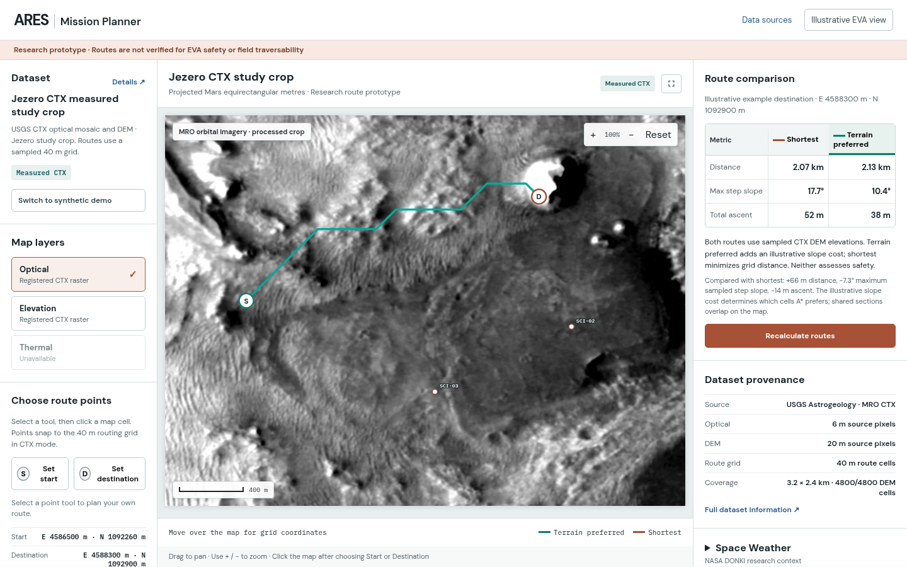
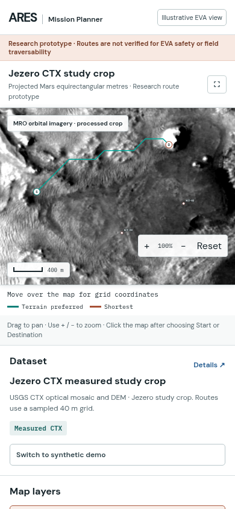

# Phase 5 application QA — 14 November 2026

## Correcting the submitted QA claim

`incoming/phase4-5/QA_TEST_REPORT.md` reports “12 passed” from `scripts/qa_test_runner.py`. Those are not twelve passed ARES application features. The script never imports `src/engine/routing.js`, the mission pack, browser UI or DONKI module. Classification of its checks:

| IDs | Actual category | Evidential limit |
| --- | --- | --- |
| QA-01, 08, 09, 10, 11 | Data validation | Count, range, text and URL-shape checks; URL shape does not authenticate coordinates or content. |
| QA-02, 05, 06 | Numerical sanity checks | Standalone great-circle distances, not ARES grid routes. |
| QA-03, 04, 07, 15 | Simulated examples | Null handling, hard-coded slope threshold, Python JSON exception and hypothetical oxygen calculation do not exercise app behavior. |
| QA-12, 13, 14 | Pending browser verification | No frontend test was executed in the submission. |
| None | Actual application integration tests | The submitted runner imports no production application module. |

The old report's 15° exclusion, 15 km EVA range and six-hour life-support result are unsupported. The current A* engine has no certified slope cutoff or oxygen budget. It uses a configurable illustrative slope cost. The old text is retained only in ignored research intake and is superseded by this report.

## Executed application checks

`npm run check` ran the Node test suite and static production build. The final run passed **24/24 tests, 0 failures**. Tests import the production routing, map-grid, mission-mode, mission-pack, science-catalog, DONKI and briefing functions. Coverage includes measured DEM routing; shortest versus terrain-preferred results; blocked destination and complete nodata barrier; arbitrary valid cell selection; zoom/pan inversion; Mars projection; in/out/null/nodata catalog decisions; malformed science JSON; mode separation; DONKI FLR/CME/SEP fixtures; empty/malformed/stale/failed and partial response states; and measured briefing contents. DOM labels and live behavior were checked in the browser rather than asserted through a duplicate test UI.

The following separate audits were executed:

- `.venv/bin/python tools/test_raster_import.py`: passed importer internal nodata barrier fixture.
- `.venv/bin/python tools/audit_ctx_rasters.py`: 36 DEM samples, maximum pack difference 0.0004375 m after JSON rounding; 4800 valid crop cells.
- `node tools/audit_ctx_routes.mjs`: A* cost matched independent Dijkstra for both route modes; an in-memory elevation change changed the path, partial nodata barrier detoured, complete barrier rejected.
- `git diff --check`: passed.

## Real browser observations

The in-app browser at `http://localhost:4173/` loaded measured CTX by default and showed shortest 2.07 km / 17.7° / 52 m versus terrain-preferred 2.13 km / 10.4° / 38 m. Custom map click set a destination to E 4,587,620 m, N 1,092,220 m and recalculated. The Science Targets panel reported Three Forks outside coverage, Delta without a single point, and the global Jezero record as research context only. The Bright Angel entry displayed the NASA rover-position evidence and outside-coverage decision. Opening Space Weather fetched seven FLR, 23 CME and zero SEP entries for 7–14 November 2026, with UTC event and retrieval times. Switching to demo loaded `mars-demo-terrain.webp` and enabled the synthetic thermal control; switching back restored `mars-optical.webp` and disabled thermal as **Unavailable**. Browser warnings/errors: none in these checks.

At a 390 × 844 viewport, the map and panels were present and document `scrollWidth` did not exceed viewport width in the browser probe. Headless Chromium screenshots were captured at 1440 × 900 and 390 × 844 and inspected. These are viewport and interaction checks, not a physical-device or comprehensive accessibility audit.

## Remaining QA limits

No production network outage was forced in the browser; unavailable/partial behavior is covered by production-module tests with failed fetch responses. No cross-browser matrix, screen-reader session, or physical mobile-device test was run. The live API may change after this date. The chosen crop has no naturally missing DEM cells, so nodata behavior is verified with controlled masks and importer fixtures.
