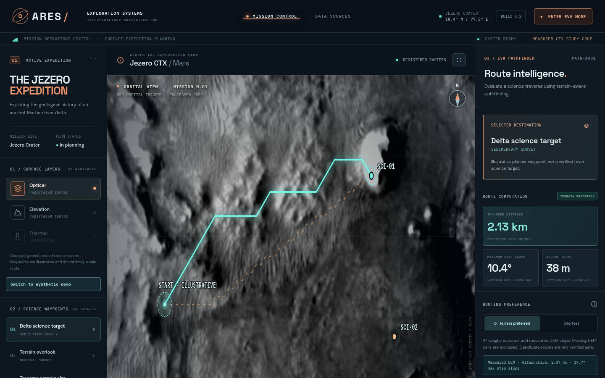

# ARES reality check — 2026-11-14

## Verdict

**PASS for the core research demonstration; PARTIAL as a mission planner.** The default app loads a real CTX optical crop and sampled CTX DEM, and A* recomputes routes from the DEM at runtime. The route is not a safe EVA route. At the time of this audit, start and destination were limited to illustrative presets and the UI obscured the comparison. Phase B addresses those usability gaps.

## Scientific data checked independently

The source files opened as GeoTIFFs in Rasterio 1.5.2. Their local metadata records identify USGS Astrogeology products and the [USGS CTX archive](https://asc-pds-services.s3.us-west-2.amazonaws.com/mosaic/mars2020_trn/CTX/index.html). Source SHA-256 values were `842b457afee7c2672022b66e3f60be836c6d52e99474015bfd9ced60099b8615` (optical) and `16a1aa66c3f48c1bca252795827db7b417876217aff0f5e1aff18027fab2327b` (DEM). These hashes establish local file identity; they do not independently authenticate the download chain.

| Source | CRS | Size | Native pixel | Projected bounds (E, N metres) | Nodata |
| --- | --- | --- | --- | --- | --- |
| CTX optical | Mars Equirectangular IAU sphere (`ESRI:103885`) | 5322 × 5040 | 6 m | E 4573663.250853–4605595.250853; N 1079453.140188–1109693.140188 | 0 |
| CTX DEM | Same CRS | 1596 × 1512 | 20 m | E 4573663.250853–4605583.250853; N 1079453.140188–1109693.140188 | −3.402822655×10³⁸ |

The shared footprint contains the pack crop E **4586000–4589200 m**, N **1091000–1093400 m**. The 80 × 60 routing grid covers that exact 3.2 × 2.4 km rectangle at 40 m per cell. Both rendered layers are 1000 × 750 pixels over the same bounds. The pack contains 4800/4800 finite DEM cells; this crop cannot demonstrate a naturally missing cell. A separate importer fixture verified an internal nodata barrier exports as `null`, and the router rejects those cells.

For an independent value check, I sampled **36 stratified cells** (six rows × six columns) from the original DEM into a fresh Rasterio `reproject` destination using the documented bilinear resampling and source nodata. Maximum absolute difference from the rounded pack was **0.0004375 m**, mean **0.0002486 m**. A separate `WarpedVRT` bilinear run differed by as much as **0.0769 m** from the pack at those cells, showing that different GDAL warp setups are not numerically identical. The pack matches the documented importer operation; the sub-millimetre comparison reflects JSON rounding, not DEM accuracy.

The local DEM metadata says elevation units are metres. The pack labels its vertical reference as the Mars 2020 IAU sphere with radius 3396190 m, consistent with the source DEM XML. The metadata also reports 9.6 m average displacement between individual CTX images and 3.8 m vertical registration between CTX DTMs. These are source-product figures, not ARES route uncertainty bounds.

## Runtime routing and metric checks

`src/engine/routing.js` reads `data.heights` for each candidate edge, computes a slope from adjacent elevation samples and horizontal grid spacing, and runs A* when a route is requested. SVG paths are generated from the returned route cells. No route-cell list is stored in the mission pack or UI.

I independently implemented Dijkstra with the same eight-neighbour geometry, blocked-cell and diagonal-corner rules, and edge-cost formula. For the first CTX target, Dijkstra and A* costs agreed exactly in the calculations below. I separately summed each returned path's horizontal lengths, positive height changes, maximum segment slope, and edge costs; each value matched the engine result at displayed precision.

| Mode | Distance | Max adjacent-cell slope | Ascent | Route cost | Independent Dijkstra cost |
| --- | ---: | ---: | ---: | ---: | ---: |
| Shortest | 2065.096680 m | 17.717381° | 52.316 m | 2065.096680 | 2065.096680 |
| Terrain preferred | 2131.370850 m | 10.438277° | 38.492 m | 2314.397563 | 2314.397563 |

The browser displayed these as **2.07 km / 17.7° / 52 m** and **2.13 km / 10.4° / 38 m** respectively, consistent with its rounding. Changing one cell on the terrain route (`x=35, y=14`) by +1000 m in an **in-memory copy** changed the optimal path so it avoided that cell. A partial nodata barrier at `x=35, y=8…49` produced a 2230.782105 m detour without entering the barrier; extending the barrier through all 60 rows returned no route. The source TIFFs and bundled pack were not altered.

## Browser observations before UI refinement

The default page loaded `public/data/mars-optical.webp`; the elevation control loaded `public/data/mars-elevation.webp`. Selecting a different preset target updated the selected target and route. Shortest and terrain controls updated the displayed metrics. `?mode=demo` loaded `mars-demo-terrain.webp` and marked the map synthetic; switching back restored the CTX image. Measured thermal was disabled and marked **Unavailable**. No JavaScript warnings or errors were logged during these interactions.

## Capability boundary

- **Functional:** registered optical and DEM crop, measured elevation array, runtime A* routing, projected metre distances, sampled step slopes and ascent, nodata exclusion, source links, synthetic fallback, briefing export.
- **Illustrative or simulated:** start and science waypoints, terrain-preference weighting, synthetic-mode hazards and thermal layer, EVA display, mission telemetry styling.
- **Not implemented or validated:** verified science-site geolocation, rover/astronaut position, field traversability or safety, thermal measurement in CTX mode, high-resolution obstacle analysis, DEM error propagation, operational mission constraints. Adjacent-cell slope on a 40 m grid can miss smaller hazards.

## Commands and evidence

Run `.venv/bin/python tools/audit_ctx_rasters.py` to repeat the read-only TIFF metadata, overlap, SHA-256 and 36-cell DEM comparison. Run `node tools/audit_ctx_routes.mjs` to repeat the controlled route mutations, independent metric sums, and Dijkstra reference checks. Browser checks used the local app at `http://localhost:4173/`. The baseline screenshot above was captured at 1440 × 900 with headless Chromium. The project test and build results for the final UI branch are recorded in `UI_REFINEMENT_REPORT.md`.
