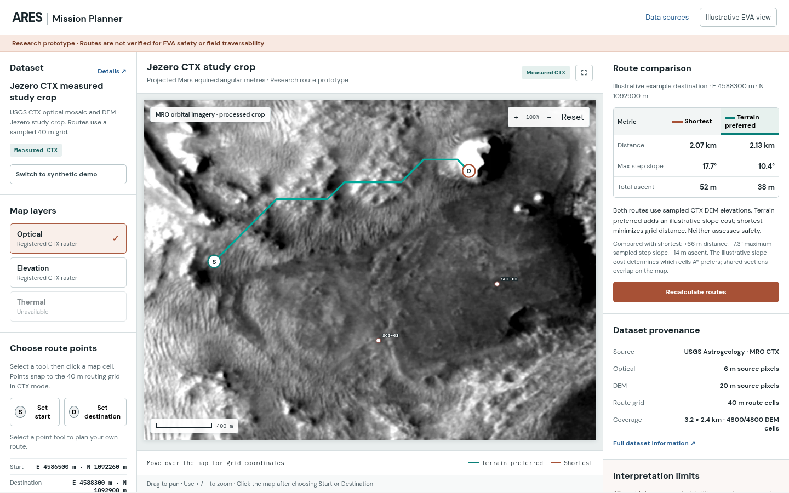
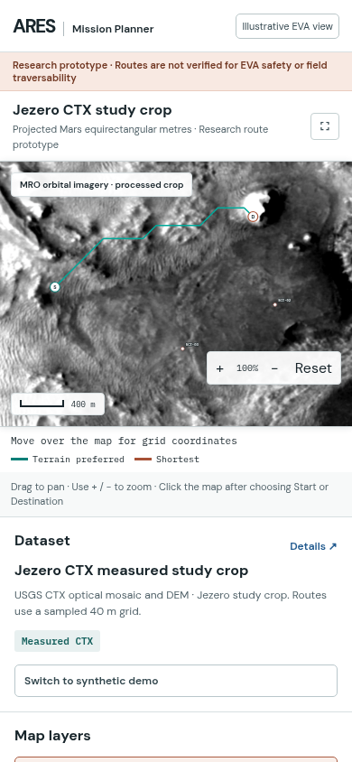
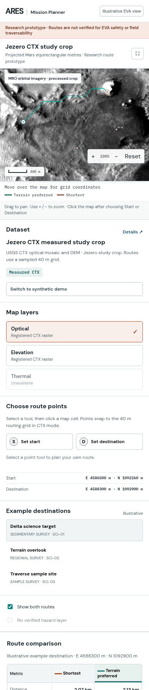

# ARES planner UI refinement — 2026-11-14

## Delivered

Branch: `feature/professional-mars-planner`, based on the reviewed CTX implementation at `7ced0a7`. The existing A* engine, CTX pack, synthetic demo, importer and sources page remain in place. The main interface now uses a restrained GIS layout: map at the centre, dataset and point tools to its left, and route comparison and provenance to its right. The mobile layout puts the map first and stacks the controls below it.

The visual layout was guided by a generated desktop concept at `/home/krr/.codex/generated_images/01a1db05-3609-7253-8f1c-fa4d2d4bfddb/exec-f4ff3f5e-d606-41e3-8341-939ac355ef99.png`. The concept was a composition reference, not data evidence. Its invented product ID, acquisition date, coordinates, resolution and “lower-risk” claim were rejected. The shipped map uses the bundled CTX image and source-backed metadata.

## Functional changes

- Select **Set start** or **Set destination**, then click the map. Browser tests confirmed both update projected metre coordinates and trigger fresh route calculations. A click snaps to a cell centre; blocked cells produce a visible rejection message. The current CTX crop has no naturally missing cells, so nodata rejection was tested with fixture and in-memory masks.
- Both route modes are computed on every point change. The comparison shows distance, maximum adjacent-cell slope and ascent side by side. Choosing a column changes the emphasized SVG path. The difference text reports signed numeric deltas and explains the illustrative slope cost.
- The raster image, routes and markers share one transformed `mapWorld`. Pointer coordinates are inverted through the same zoom and pan transform before grid selection. The measured scale bar is calculated from the 3.2 km crop width and current zoom; demo mode labels its grid illustrative.
- The provenance panel shows the USGS/MRO source, 6 m optical pixels, 20 m DEM pixels, 40 m routing cells and 4800/4800 DEM coverage. The details dialog includes exact source URLs, CRS, bounds and vertical reference.
- The synthetic demo remains separate. Measured thermal is disabled and **Unavailable**; demo thermal is explicitly synthetic. Briefing JSON export and the illustrative EVA view remain available.
- The default page waits for the measured pack before painting terrain, so it does not briefly show the synthetic raster under a CTX label. If the pack fails validation or loading, the app switches to the labeled synthetic fallback.

## Verification performed

| Check                                          | Result                                                                                                                                                             |
| ---------------------------------------------- | ------------------------------------------------------------------------------------------------------------------------------------------------------------------ |
| `npm run test`                                 | Passed, 15 tests. Includes map click conversion with zoom/pan, arbitrary valid point routing, nodata rejection and mode regression.                                |
| `npm run build`                                | Passed; `planner.css` and the measured pack are included in `dist/`.                                                                                               |
| `.venv/bin/python tools/test_raster_import.py` | Passed internal nodata-barrier fixture.                                                                                                                            |
| `git diff --check`                             | Passed.                                                                                                                                                            |
| Browser default                                | CTX optical loaded; route comparison showed 2.07 km / 17.7° / 52 m versus 2.13 km / 10.4° / 38 m; no console errors.                                               |
| Browser map controls                           | Clicking start and destination tools and the map updated projected coordinates and recalculated routes. Selecting a preset after a custom start changed the route. |
| Browser zoom and pan                           | Zoom advanced from 100% to 120%; drag changed the shared `mapWorld` pan to 65.1 px, 35 px. No console errors.                                                      |
| Browser layers and modes                       | Elevation switched to `mars-elevation.webp`; CTX thermal stayed disabled. Demo loaded its synthetic map and thermal image; switching back loaded CTX optical.      |
| Browser export                                 | Downloaded JSON contained measured dataset, start, destination, shortest route and terrain-preferred route. The test download was removed afterward.               |
| Screenshot inspection                          | Desktop 1440 × 900, mobile 390 × 844 and taller mobile 390 × 1800 captured with headless Chromium and visually inspected.                                          |

## Design comparison and corrections

| Point      | Concept direction                       | Rendered result                                                                                                                 |
| ---------- | --------------------------------------- | ------------------------------------------------------------------------------------------------------------------------------- |
| Layout     | Map-dominant three-column GIS tool      | Central CTX map with left controls and right comparison; mobile map first.                                                      |
| Typography | Large plain headings, compact data text | DM Sans with restrained size hierarchy; IBM Plex Mono for coordinates and scale.                                                |
| Palette    | Light slate, muted rust, teal route     | White/slate workspace, rust actions and shortest line, teal terrain line.                                                       |
| Map        | Unobstructed grayscale imagery          | Actual CTX optical crop, no decorative color wash, gradients or telemetry overlay.                                              |
| Route copy | Side-by-side metrics and explanation    | Measured values, signed deltas, explicit safety caveat.                                                                         |
| Provenance | Compact data table                      | Source organization and actual native/grid resolutions; invented concept details omitted.                                       |
| Mobile     | Map before tools                        | 390 px layout shows map, layer and point tools, then route comparison without horizontal overflow in the inspected screenshots. |

The actual route geometries overlap on many cells, so the two lines are less separated than in the concept image. Offsetting them for appearance would misrepresent their locations. The app instead distinguishes them by color, line style and selected comparison column.

## Screenshots

Desktop, 1440 × 900:

Mobile, 390 × 844:

Mobile detail continuation, 390 × 1800:

## Remaining limits

The selected CTX crop has 4800 valid cells; the visible nodata rejection state cannot be demonstrated on this crop without changing the data. Routing remains a research comparison on a 40 m sampled grid. Neither route mode checks local obstacles, geotechnical properties, time-dependent conditions or operational constraints. Example waypoints are illustrative. Browser QA covered the in-app browser and headless Chromium screenshots at the stated sizes; no cross-browser or physical-device test was run.
