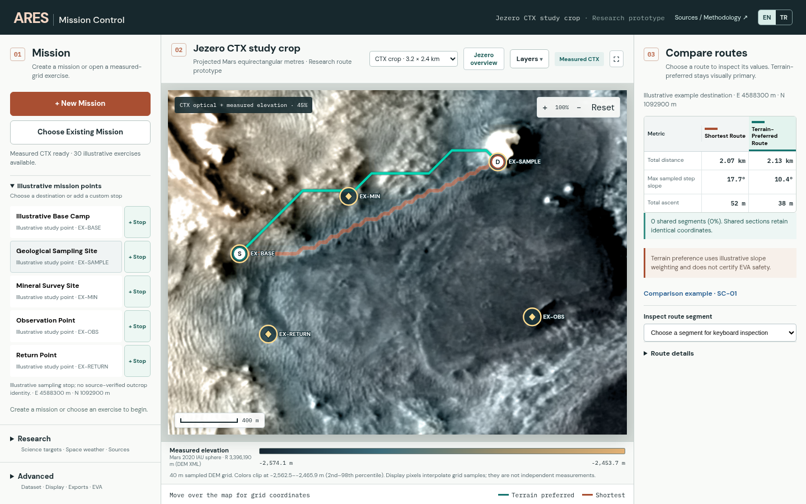
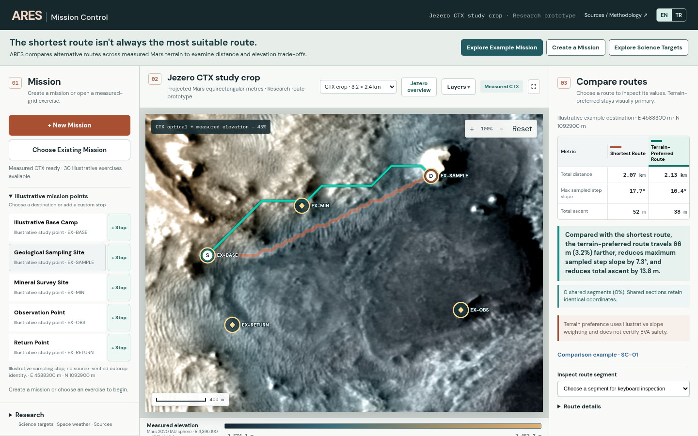
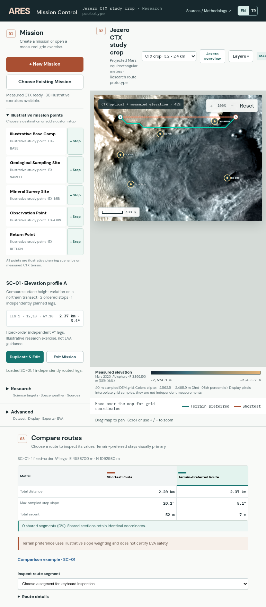
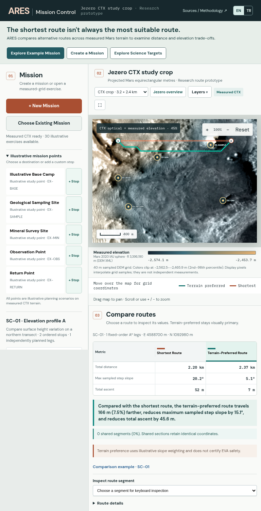

# Phase 10 PR #13 QA report

## Scope and environment

Review of the incremental jury-readiness PR, not completion of the full Phase 10 brief. Baseline screenshots are from production `https://spcapps.openstacktool.com/` at build `ea947690f5a5`; after screenshots are from the local PR checkout. Chromium used `/usr/bin/chromium` with Playwright. `npm run check` and `npm run test:browser` are the release commands. Screenshots can be reproduced with `node tools/capture_phase10_qa.mjs` while the local server runs on port 4173.

## Findings and corrections

| Finding                                                                             | Evidence                                                                                          | Correction                                                                                                                        | Verification                                                                |
| ----------------------------------------------------------------------------------- | ------------------------------------------------------------------------------------------------- | --------------------------------------------------------------------------------------------------------------------------------- | --------------------------------------------------------------------------- |
| SC-05 has different geometry and equal length; the first PR could say “0 m farther” | Recomputed `comparisonFacts` has `distanceDelta: 0`, `identical: false`, `slopeReduction: 2.438°` | Equal-distance branch states the same measured distance and actual slope/ascent changes                                           | Catalog unit cases SC-05, EX-05, SC-10; browser selection of SC-05 in EN/TR |
| Source-code regex did not prove SC-01 launch                                        | Previous Phase 10 test inspected JS text                                                          | Added Playwright clicks and state assertions for crop switch, SC-01, both paths, zoom, landmarks, confirmation, and EN/TR summary | `npm run test:browser`                                                      |
| 768 px layout left a large blank region between map and comparison                  | Matched tablet screenshots show the baseline comparison starting below the sidebar's height       | Grid rows now size to map content; map header wraps and comparison starts immediately after map                                   | 768×1024 screenshot and geometry assertion (`compare.y - map.bottom < 24`)  |
| Local dev console shows 404s for `build-info.json` and `favicon.ico`                | Browser console sweep identified those exact URLs; production build serves `build-info.json`      | Classified as expected local-server requests; unexpected console errors and page exceptions still fail the sweep                  | EN/TR browser suite                                                         |

## Executed checks

| Check                  | Result                                                                                                                                                                                                                                         |
| ---------------------- | ---------------------------------------------------------------------------------------------------------------------------------------------------------------------------------------------------------------------------------------------- |
| `npm run check`        | 68 Node tests passed; static build completed (42 files, 1,438,729 bytes)                                                                                                                                                                       |
| `npm run test:browser` | 10 Chromium tests passed, covering SC-01, SC-05, confirmation cancel/accept, region switch, route visibility, language changes, keyboard map point, destination, landmark, custom stop, segment inspection, route styles and source navigation |
| Responsive widths      | 1440×900, 1280×720, 768×1024, 390×844, 320×720 in both EN and TR; no document overflow or clipped comparison bounds in the automated sweep                                                                                                     |
| Emulated touch         | 390 and 320 px tap interactions for mission launch and science targets passed                                                                                                                                                                  |
| Screenshot comparison  | Production before and local after at 1440×900 first screen and 768×1024 SC-01 route view                                                                                                                                                       |

Physical touch hardware, screen reader output, cross-browser behavior, DONKI live-service error injection in the browser, import/export UI, and complete submission-portal requirements remain unverified. The browser suite opens the science catalog but does not establish a routeable scientific target. A passing DOM visibility assertion does not establish field usability.

## Before and after screenshots

The desktop pair shows the new mission purpose and entry actions; the tablet pair shows the map-to-comparison gap closed. All four files are attached in this directory for PR review.

**Before — production desktop**

**After — PR desktop**

**Before — production tablet SC-01**

**After — PR tablet SC-01**

